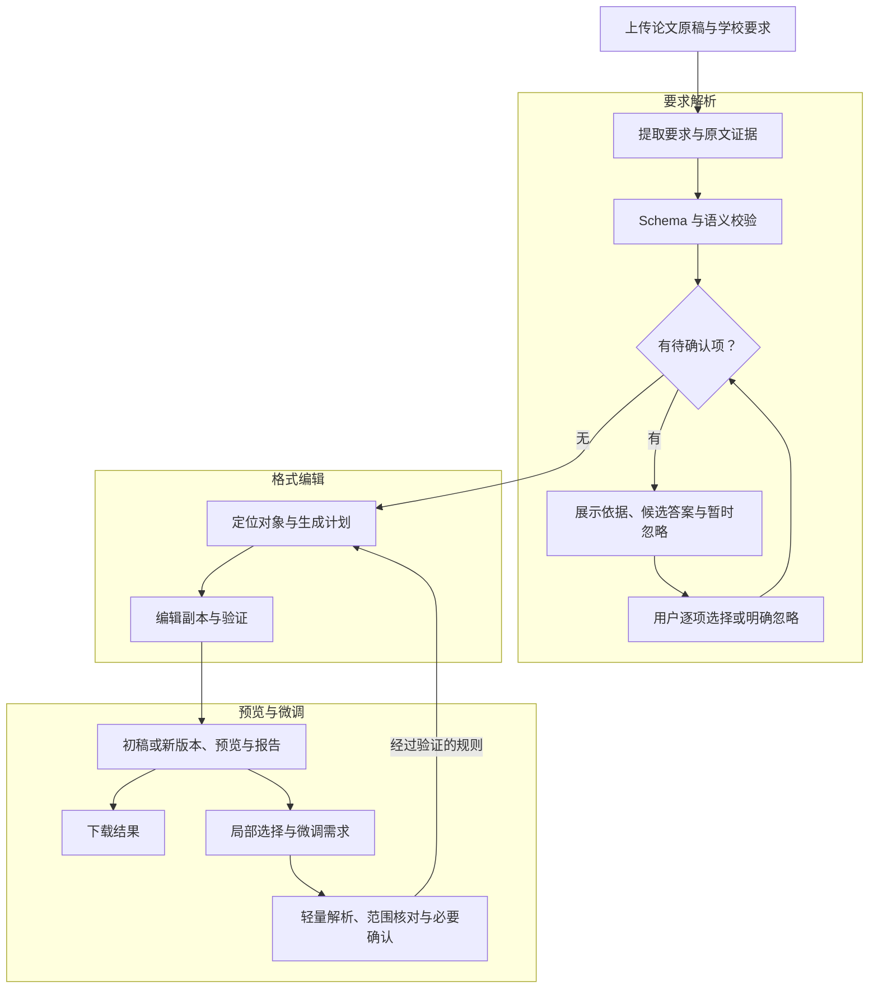

# EasyFormat 宣传网站文字素材

审核稿，更新日期：2026-10-08。所有【占位符】等待真实数据；功能清单统一展示完整产品规划。网页在同一页展示四个部分：产品简介、技术设计与产品 workflow、AI选型&产品调优、商业分析。

## 项目简介

**EasyFormat：让论文格式调整更省时、更清楚、更可控。**

完成论文写作之后，字体、标题、行距、页边距、目录和表格，仍可能需要反复调整。EasyFormat 将学校的格式要求与论文文档连接起来，减少逐条查阅、手动修改和重复检查的工作。使用 EasyFormat，格式调整与复核耗时可从【H】小时缩短至【M】分钟，首轮解决支持范围内【R】% 的格式问题。

**上传原稿与要求，一键开始；按需确认，自动排版。** 仅需上传学校说明或模板与论文 DOCX，系统提取规则、展示需要确认的疑问，再完成可靠的格式修改，生成可继续编辑的论文、报告和预览。没有疑问时直接继续。

**全文排版，局部微调。** 在预览中选中文字、提出需求，按指定范围调整细节。保留原稿与历史版本，展示修改依据、位置与验证结果。

| 格式类别 | 格式内容 |
|---|---|
| 字体与字符 | 字体、字号、加粗、斜体、颜色、下划线、删除线、上下标、字符间距与缩放；中文、西文和数字分别设置 |
| 段落 | 对齐、行距、段前段后间距、首行／悬挂／左右缩进、制表位、引导符、边框与底纹、孤行与分页控制 |
| 标题 | 各级标题字体、字号、字形、对齐、缩进与间距；标题层级、多级编号、章节起始和目录联动 |
| 页面与分节 | 纸张、方向、页边距、装订线、分栏、文字方向、镜像页边距、分节和章节独立设置 |
| 页眉、页脚与页码 | 文字外观、位置与距离、页码样式与起始值、首页不同、奇偶页不同、章节页眉和连续编号 |
| 目录与交叉引用 | 目录层级与条目外观、手工目录转换、图表目录、交叉引用和字段更新 |
| 表格 | 三线表、全框线、无边框、表内文字、行高列宽、单元格边距与对齐、重复表头、跨页控制与复杂边框 |
| 图片与题注 | 图片尺寸、位置、对齐与环绕；题注字体、字号、编号、位置和图文间距 |
| 列表与编号 | 项目符号、编号样式、缩进、编号连续性、多级列表和列表文字外观 |
| 注释、引用与参考文献 | 字体、字号、缩进、间距、脚注尾注编号、分隔线和外观一致性 |
| 公式 | 字体、字号、对齐、编号和公式间距 |

<small>部分内容仍在开发中，实际功能可能产生变动</small>

## 技术设计与产品 workflow

**要求解析：稳定、高效、可复用的 Brief Parsing。**

读取学校说明与模板，区分明文要求、模板观察、示例和背景。每条格式候选关联原文证据；输出受 JSON Schema 约束，再核对属性、值、单位、条件和范围。要求提取、覆盖审计与争议分析分别承担职责，缺失或无依据的信息保留为待确认项。固定模型及 Prompt 版本，设置超时、重试和 Token 预算，通过版本化接口、解析 Bundle 和领域包接入不同宿主与模型。

**有疑问先确认，在修改前做决定。** 解析完成后，系统展示疑问、原文、影响范围与候选答案。用户可选择一个答案或暂时忽略；未回答时不开始格式编辑。暂时忽略不等于默认同意，相关项目保留在报告中。

例如：“正文存在两种字体要求，请选择本次采用的规则。”可提供“采用宋体”“采用黑体”“暂时忽略此问题”三个选项。可靠明文规则无需逐条询问。

**格式编辑：确定性执行，逐项验证。**

使用 C#／.NET 与 Open XML SDK 定位论文对象、生成计划并编辑副本。只执行经过验证的类型化规则，保存后重新读取实际格式、结构和文字内容，保留原稿及历史版本。规则快照绑定到本次编辑，避免用户改答后仍发布过期结果。

**预览与微调：看见结果，调整细节。**

使用 LibreOffice 与 PDF.js 展示预览、报告和版本。局部微调将选区与需求转成受验证的规则，明确实际作用范围；定位不唯一或存在冲突时先确认。后续只重新处理受影响对象，生成独立新版本。反馈解析与范围确认已逐步接入，实际反馈编辑仍在完善。

**【产品原型展示位】**

放置视频、交互原型或截图：上传文件 → 编辑前选项确认 → 初稿预览与报告 → 局部微调 → 历史版本。当前能力用实际原型展示，规划交互用设计稿说明。

## AI选型&产品调优

当前解析模块默认接入固定版本的 Qwen Flash，并保留 OpenAI 适配器。围绕中文格式理解、结构化输出、范围保留、响应时间和单任务费用，用同一评测集比较配置与模型。

调优优先采用领域词汇、示例与 Prompt 优化、上下文组织、参数实验和确定性校验。模型输出经验证后进入文档执行链路；Schema 合格并不能单独证明语义正确，原文证据与范围核验同样必要。

网站重点展示五项指标，并将每项结果与具体调优方法对应：

| 关键指标 | 调优前 → 调优后 | 可采用的调优方法 |
|---|---|---|
| 格式要求提取 F1 | 【F₀】% → 【F₁】% | 扩充领域词汇与中英文对照示例；优化提取／审计 Prompt；用漏提与误提取样本回归，分别记录准确率与召回率 |
| 无原文支持候选占比 | 【U₀】% → 【U₁】% | 强制引用真实证据 ID；加入示例与模板误判的反例；Schema 校验后再核对原文证明，拒绝无法证明的候选 |
| 对象与作用范围准确率 | 【S₀】% → 【S₁】% | 调整条款切分与相邻上下文；补充章节、中文／西文、条件与例外示例；验证完整范围，防止局部要求扩大 |
| Brief 解析 P95 耗时 | 【L₀】秒 → 【L₁】秒 | 对照思考模式与输出长度；优化分块、并发和争议分析触发条件；设置超时与有限重试 |
| 单任务模型费用 | ¥【C₀】 → ¥【C₁】 | 压缩无关上下文；按必要阶段调用；复用已验证结果与决定快照；记录输入／输出 Token、失败和重试费用 |

以上全部为待实测占位符。比较时固定评测集，记录模型、Prompt、参数、运行条件与计费口径；配置与流程调优不表述为已完成模型训练。无原文支持候选占比在程序过滤前测量，另记录过滤后残留情况，避免用“全部拒绝”掩盖提取质量。

## 商业分析

商业设计贯穿处理链路：AI 聚焦 Brief 理解，程序负责格式编辑；通过明确问题减少误改与返工，通过规则及结果复用控制调用成本，通过可替换的渲染器与存储接口控制初期投入并支持后续扩展。单任务成本同时统计模型、渲染、版本存储、失败重试与人工支持。
