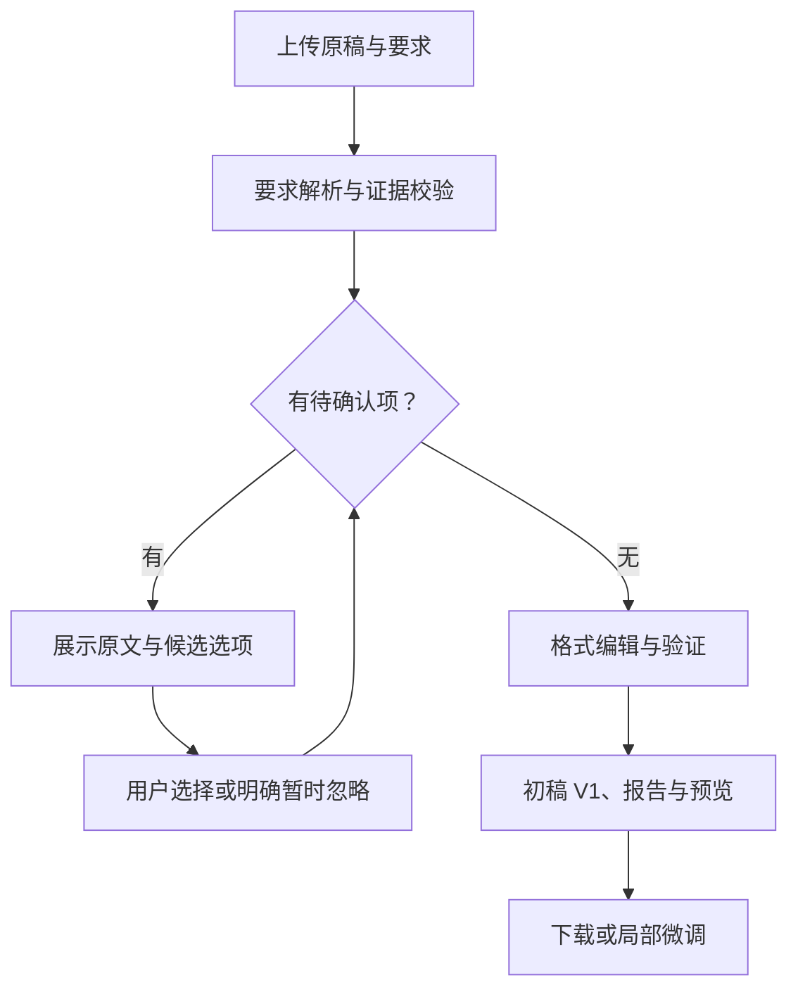

# 首次格式编辑前确认

日期：2026-10-07。依据用户本轮确认的产品工作流变更；替代此前“先发布 V1，再询问”的顺序。

## 当前行为

上传 Brief 和论文 DOCX 后，先安全保存不可变 V0 和解析 Bundle。可靠明文规则不逐条询问；条件、冲突、来源差异、缺值和模板采用策略等待确认项，在编辑前以问题队列展示。

用户可以选择候选规则、提交场景、模板采用策略、受支持的格式值，或明确“暂时忽略此问题”。未回答、被前置问题阻塞或仅暂缓时，不调用编辑器或渲染器。暂时忽略记录为 `skip`，不猜值、不默认接受模板，保留在报告中。没有待确认项的任务直接继续生成 V1。

所有待确认项已回答或明确忽略后，用户点击“开始格式编辑并生成初稿”。编辑器读取来源重放后的有效规则快照，在 V0 的副本上编辑、验证和渲染；发布事务再次核对当前规则快照。编辑期间改答会使旧结果发布失败，原稿与既有历史保持不变。

## 契约与接口

- `POST /api/tasks`：`task-intake/1.2`。有问题时返回 `needs_user_input / reviewing_requirements`，初稿字段为 null；无问题时返回 V1。1.0／1.1 历史 Schema 保持不变。
- `GET /api/tasks/{task_id}/initial-review`：`initial-review/1.0`，返回原稿身份、规则快照、问题和处理阶段。可在应用重启后恢复。
- `GET /api/tasks/{task_id}/questions`、`POST .../decisions`：从 V0 开放，沿用原有类型化回答、来源重放、幂等、并发和修订检查。回答本身不编辑论文。
- `POST /api/tasks/{task_id}/initial-draft`：`initial-draft-request/1.0`，绑定 V0、DOCX SHA-256 和期望规则快照。仍有待确认项或快照已变化时拒绝执行；同一初稿发布可重试，不创建重复 V1。旧正文对齐接口不能绕过首次确认和初稿发布入口。
- `scripts/export_initial_review_schemas.py`：导出两个新增宿主契约。

新任务的决定历史以 V0 为稳定锚点；已有 V1 锚点历史按原身份重放，不迁移或重写。解析 Bundle、解析编译器和历史 Schema 未改变，仅调整宿主中的确认与编辑时机。

## 前端与范围

连接配置了 intake 的完整本地 API 时，`apps/web` 在仅有 V0 的任务中展示逐题确认卡片；候选按钮没有默认提交，明确忽略后才能继续。原文和选项使用文字节点渲染，不执行 HTML。响应丢失时沿用原请求 ID 重试。生成初稿后自动进入 V1 预览。

需要填写复杂范围的条件或未提供专用输入控件的属性，当前页面可先明确暂时忽略；完整类型化回答仍可通过既有决定 API 提交。独立 `preview_host` 仍用于既有预览，未增加上传、模型解析和初稿发布组件。预览反馈实际编辑继续属于后续阶段。

## 验证

覆盖编辑前拒绝执行、选答与明确跳过、问题阶段顺序、重启恢复、响应丢失重试、原稿保持、来源重放、规则选择用于真实 .NET 编辑、编辑期间改答拒绝发布，以及原有预览／反馈回归。

本轮完整回归：AutoFormat 223 项通过、5 项跳过；Brief Parsing 复制版 391 项通过、2 项跳过；.NET 编辑核心 243 项检查通过；浏览器 21 项通过、2 项跳过。界面文字和输入保留调整后，另跑新增浏览器用例 2 项通过。环境相关跳过项及来源项目基础设施测试排除方式沿用现有回归约定。

补齐旧正文对齐入口限制后，针对首次确认、兼容编辑接口及反馈 API 的回归为 39 项通过、1 项跳过，其中包含 3 项绕过限制回归用例。
